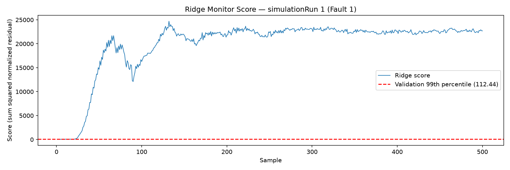

# Mini Project Report

Group Member:

Wenyin He(wenyinh)

Cosette Zhou(cosettez)

## 1. The Plant and the Task

## 2. The Two Detectors

### Ridge forecast monitor

We trained a multi-output `Ridge(alpha=1.0)` model on normal runs 1–300. We used the training mean and sample standard deviation (`ddof=1`) to standardize all 52 channels. The model uses the previous two samples to predict the current sample. This gives 104 inputs and 52 outputs. We built the inputs separately for each run, so they never include data from another run. The first two samples of each run have no score.

For each channel, we calculated the prediction error and divided it by the standard deviation of that channel's training errors. We then squared these values and added them to get the Ridge score:

$$
s_t = \sum_{j=1}^{52}\left(\frac{z_{t,j}-\hat z_{t,j}}{\sigma_{e,j}}\right)^2.
$$

We set the threshold to the 99th percentile of scores on normal validation runs 301–400, which was **112.4423**. A sample was marked as an alarm only if its score and the previous two scores in the same run were all strictly above this threshold. We used normal runs 401–500 to check false alarms.

*Ridge score for Fault 1, Run 1. The fault starts after sample 20. The first alarm is at sample 24, giving a delay of 12 minutes.*

## 3. Results

### Ridge results

Ridge had no false alarms in the normal test runs. None of the 49,800 scored samples met the alarm rule, so the false-alarm rate was **0.00%**. In the table, detection rate is the percentage of samples after sample 20 that were in alarm, averaged over the 20 runs. We calculated delay as `(first alarm sample − 20) × 3` minutes and report the median for runs with a post-fault alarm. The last column counts runs with no post-fault alarm. A dash means all runs were missed.

| Fault | Detection rate (%) | Median delay (min) | Runs missed / 20 |
| --- | ---: | ---: | ---: |
| 1 | 99.35 | 12 | 0 |
| 2 | 96.51 | 51 | 0 |
| 3 | 0.00 | — | 20 |
| 4 | 96.89 | 9 | 0 |
| 5 | 99.58 | 9 | 0 |
| 6 | 99.58 | 9 | 0 |
| 7 | 99.58 | 9 | 0 |
| 8 | 95.45 | 52.5 | 0 |
| 9 | 0.00 | — | 20 |
| 10 | 69.76 | 67.5 | 0 |
| 11 | 45.35 | 33 | 0 |
| 12 | 95.69 | 30 | 0 |
| 13 | 90.18 | 138 | 0 |
| 14 | 99.54 | 9 | 0 |
| 15 | 0.00 | — | 20 |
| 16 | 71.19 | 45 | 0 |
| 17 | 86.69 | 118.5 | 0 |
| 18 | 89.27 | 141 | 0 |
| 19 | 2.92 | 121.5 | 0 |
| 20 | 63.51 | 151.5 | 0 |

## 4. Comparison

### Ridge response

Ridge checks how much the current values differ from its predictions based on the previous two samples. Ten faults had detection rates above 90%. For Fault 19, every run had at least one alarm, but only 2.92% of samples after the fault were in alarm. The median delay was 121.5 minutes. Ridge detected this fault at least once in every run, but most samples after the fault were not in alarm.

## 5. Faults Nobody Catches

### Ridge misses

Ridge missed Faults 3, 9, and 15 in all 20 runs. Fault 3 is a step change in D-feed temperature, and Fault 9 is random variation in the same temperature. Fault 15 is a sticking condenser cooling-water valve. [Russell, Chiang and Braatz (2000), Table 1 and p. 90](https://web.mit.edu/braatzgroup/36_Fault_detection_in_industrial_processes_using_canonical_variate_analysis_and_dynamic_principal_component_analysis.pdf) also found these faults hard to detect, with little visible change in the means or variances of individual variables. Our findings are similar, but the methods and settings differ, so the numbers cannot be compared directly.

## 6. Diagnosis

### Ridge contributions

For each fault, we collected all alarm samples after sample 20 from the 20 runs. We averaged each channel's squared normalized residual over these samples and saved the top five channels. Faults 3, 9, and 15 have no ranking because they had no post-fault alarms. We used the [original TEP simulation code](https://github.com/camaramm/tennessee-eastman-profBraatz/blob/master/teprob.f) to check the channel meanings and fault definitions.

| Fault | Main Ridge contributions | Physical interpretation |
| --- | --- | --- |
| 4: reactor cooling-water inlet temperature step | `xmv_10` (120.74): reactor cooling-water flow input; `xmeas_9` (5.64): reactor temperature | The main channels are related to reactor cooling. The large contribution from `xmv_10` may come from the controller responding to the temperature change. |
| 6: loss of A feed | `xmeas_1` (318638.93): measured A-feed flow; `xmv_3` (234049.54): manipulated A-feed input | Both channels measure or control the A feed, which matches the fault. |
| 14: reactor cooling-water valve sticking | `xmeas_21` (121.85): cooling-water outlet temperature; `xmeas_9` (77.19): reactor temperature; `xmv_10` (70.08): cooling-water flow input | These channels suggest a change in heat removal when the cooling-water valve sticks. |

The contributions show which channels had large normalized prediction errors. They do not prove the root cause. Because the errors are squared, they also do not show whether a variable increased or decreased.

## 7. Limits

### Ridge limitations

Ridge is a linear model and only uses the previous two samples. It may miss changes that need a longer history to detect. It can also miss a fault if the recent values still give accurate predictions. We saw no false alarms in the normal test runs, but this may change under other operating conditions. These simulations contain one fault at a time. They do not tell us how the model would perform with sensor failures, several faults at once, or changes in the plant over time.

## 8. AI Use

Wenyin used GenAI to help refactor the Ridge code, check the assignment requirements and numerical results, and draft the Ridge report sections. The scores, evaluation results, and channel contributions were checked against the official reference calculations. The fault descriptions and channel names were checked against the sources linked above.

## Appendix: Member Contributions

- **Wenyin He — Andrew ID: `wenyinh`.** Prepared the Ridge data, built lagged features, trained the model, and added model saving and loading. Combined and fixed the scoring and plotting scripts. Added threshold export, the three-point alarm rule, detection metrics, and channel rankings based on alarm samples. Wrote the Ridge report sections.
- **Cosette Zhou — Andrew ID: `cosettez`.** Wrote the first Ridge scoring script, including the squared normalized residuals for each channel. Also wrote the first plotting script and made the example figure.
