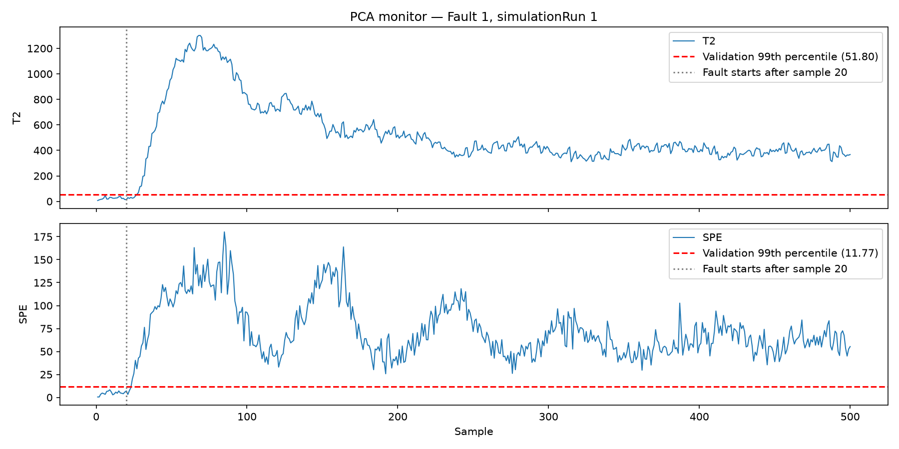

# Mini Project Report

Wenyin He (wenyinh) · Cosette Zhou (cosettez) · Vidhi Kothari (vidhikot) · Meet Bhatt (mbbhatt)

## 1. The Plant and the Task

The Tennessee Eastman Process (TEP) is a standard process-monitoring benchmark: a simulation of a real Eastman Chemical plant, with the chemistry disguised. Gaseous feeds (A, C, D, E and an inert B) react to form two liquid products (G, H) and a by-product (F). The effluent passes through a condenser, a separator and a stripper, and a compressor recycles unreacted gas. A control system constantly adjusts valves to hold temperatures, pressures and levels at their set points. We monitor 52 channels sampled every 3 minutes: 41 measurements (`xmeas_1`–`xmeas_41`) and 11 manipulated variables, which are the controller outputs (`xmv_1`–`xmv_11`).

The simulator can introduce 20 types of faults. Examples include feed composition steps, loss of a feed, random variation in a cooling-water temperature, sticking valves, a kinetics drift, and five faults of unknown type. We have 500 fault-free runs and 20 runs per fault. Each run has 500 samples (25 h), and in the faulty runs the fault starts after sample 20. As in a real plant, where no examples of future faults exist, the detectors are trained **only on normal data**. The fault-free runs are split into training (runs 1–300), threshold validation (301–400) and false-alarm testing (401–500). We compare a PCA model with two statistics ($T^2$, SPE) against a Ridge model that predicts each sample from the two before it.

## 2. The Two Detectors

Both detectors standardize all 52 channels with the training mean and sample standard deviation (`ddof=1`). Each threshold is the 99th percentile of the statistic on validation runs 301–400. A sample is an alarm only when it and the two samples before it in the same run are all strictly above the threshold.

**PCA.** PCA checks each sample on its own against the normal correlation structure. We kept the smallest number of components that explains at least 90% of the training variance: **k = 31** (90.18%). With loadings $P$ ($52\times31$), scores $t = P^\top z_t$, and training score variances $\lambda_i$:

$$
T^2_t = \sum_{i=1}^{k}\frac{t_i^2}{\lambda_i}, \qquad
\mathrm{SPE}_t = \lVert z_t - P P^\top z_t \rVert^2 .
$$

$T^2$ measures movement *inside* the model space, and SPE measures the part of the sample the model *cannot* rebuild. The thresholds are 51.80 ($T^2$) and 11.77 (SPE).

**Ridge.** A multi-output `Ridge(alpha=1.0)` model predicts the current standardized sample (52 outputs) from the previous two (104 inputs). Inputs never cross runs, so the first two samples of a run are not scored. The score sums the squared prediction errors, each divided by that channel's error standard deviation in training:

$$
s_t = \sum_{j=1}^{52}\left(\frac{z_{t,j}-\hat z_{t,j}}{\sigma_{e,j}}\right)^2, \qquad \text{threshold } 112.44 .
$$

*Fault 1, Run 1. The fault starts after sample 20, and dashed lines mark the thresholds. Ridge alarms first, at sample 24 (12 min). SPE follows at sample 26 (18 min) and $T^2$ at sample 29 (27 min). All three stay far above their thresholds for the rest of the run.*

## 3. Results

Each cell gives the detection rate (% of post-fault samples in alarm, averaged over 20 runs) and, in parentheses, the median delay in minutes, $(\text{first alarm} - 20)\times 3$. The median is taken over runs with a post-fault alarm. The best rate for each fault is in bold.

| Fault | Description | Ridge | PCA $T^2$ | PCA SPE |
| ---: | --- | ---: | ---: | ---: |
| 1 | A/C feed ratio, step | **99.4** (12) | 98.5 (25.5) | 99.2 (15) |
| 2 | B composition, step | 96.5 (51) | **97.3** (39) | 95.9 (57) |
| 3 | D feed temperature, step | 0.0 (—) | 0.0 (—)\* | 0.0 (—) |
| 4 | Reactor cooling-water inlet temp., step | 96.9 (9) | 9.1 (64.5) | **99.4** (12) |
| 5 | Condenser cooling-water inlet temp., step | **99.6** (9) | 33.2 (9) | 12.5 (15) |
| 6 | A feed loss | **99.6** (9) | 97.9 (33) | **99.6** (9) |
| 7 | C header pressure loss | **99.6** (9) | **99.6** (9) | **99.6** (9) |
| 8 | A, B, C feed composition, random | **95.5** (52.5) | 94.2 (70.5) | 82.2 (67.5) |
| 9 | D feed temperature, random | 0.0 (—) | 0.0 (—)\* | 0.0 (—) |
| 10 | C feed temperature, random | **69.8** (67.5) | 8.5 (471) | 17.7 (177) |
| 11 | Reactor cooling-water inlet temp., random | **45.4** (33) | 25.8 (43.5) | 43.4 (40.5) |
| 12 | Condenser cooling-water inlet temp., random | **95.7** (30) | 94.4 (37.5) | 86.7 (48) |
| 13 | Reaction kinetics, slow drift | **90.2** (138) | 88.4 (159) | 89.3 (136.5) |
| 14 | Reactor cooling-water valve, sticking | **99.5** (9) | 97.8 (12) | 78.4 (13.5) |
| 15 | Condenser cooling-water valve, sticking | 0.0 (—) | 0.0 (—)\* | 0.0 (—) |
| 16 | Unknown | **71.2** (45) | 1.9 (690)† | 10.1 (156) |
| 17 | Unknown | 86.7 (118.5) | 66.6 (138) | **86.8** (118.5) |
| 18 | Unknown | **89.3** (141) | 87.1 (175.5) | 88.4 (151.5) |
| 19 | Unknown | **2.9** (121.5) | 1.0 (471) | 0.3 (610.5)† |
| 20 | Unknown | **63.5** (151.5) | 13.6 (186) | 43.2 (165) |
| — | **False-alarm rate**, normal runs 401–500 | 0.00 | 0.052 | 0.00 |

\* $T^2$ alarmed in only one of the 20 runs, at 231 min, with a rate of 0.01–0.02%. This is no higher than its false-alarm rate, so we count the fault as missed. † Some runs had no post-fault alarm: 3 runs for $T^2$ on Fault 16 and 6 runs for SPE on Fault 19. In all other cells with a nonzero rate, all 20 runs had at least one post-fault alarm.

## 4. Comparison

**$T^2$ versus SPE.** $T^2$ responds to normal patterns that are too large, and SPE responds to new patterns. Faults 4 and 14, both in reactor cooling, show the split. In Fault 4, the controller raises the cooling-water flow (`xmv_10`) while holding the reactor temperature (`xmeas_9`) at its set point. One channel moves without its usual partner, which is a new pattern, so SPE catches 99.4% and $T^2$ only 9.1%. Russell et al. (2000, Table 4) found the same: PCA Q missed 3.8% of samples and $T^2$ missed 95.6%. In Fault 14, the same two channels swing in their normal opposite-sign pattern, only much harder, so $T^2$ catches 97.8% and SPE 78.4%. Russell et al.'s Q missed nothing on Fault 14; how a fault splits between the two depends on k, the thresholds and the data, which differ from ours.

**Ridge versus PCA.** On large step and drift faults (1, 2, 6–8, 12, 13, 17, 18) the best PCA statistic is within a few points of Ridge. Ridge does far better on two kinds of fault:

- *Fault 5* (condenser cooling-water step). The PCA alarms stop at about sample 200, roughly 9 h after the fault starts, once the control loops have settled. By then `xmv_11` is shifted by only about 1.9 standard deviations, but Ridge keeps alarming. Russell et al. (2000, pp. 90–91) report the same: PCA misses about 75% of samples, its Q statistic drops below the threshold about 10 h after the fault, and only the dynamic CVA statistics catch the fault throughout.
- *Faults 10, 16, 19, 20* (random-variation and unknown faults). Each sample looks normal; what changes is how the channels evolve over time, which memoryless PCA cannot see but Ridge's one-step prediction error can. Russell et al. found the same split: PCA Q misses 55–87% of samples on these faults, while the dynamic CVA $T_r^2$ misses only 2–10%. Fault 19 is still weak for Ridge, with only 2.9% of post-fault samples in alarm.

## 5. Faults Nobody Catches

All three statistics miss **Faults 3, 9 and 15**: a step and a random variation in D-feed temperature, and a sticking condenser cooling-water valve. A static and a dynamic model both fail, which points to the data: the control loops absorb these disturbances, or the sensors barely register them. Russell, Chiang and Braatz ([2000](https://web.mit.edu/braatzgroup/36_Fault_detection_in_industrial_processes_using_canonical_variate_analysis_and_dynamic_principal_component_analysis.pdf), Table 4 and p. 90) agree. Every PCA, dynamic PCA and CVA statistic they tested missed 90.3–99.8% of samples on these faults. They saw no visible change in any variable's mean or variance and excluded these faults from their comparison. A data-driven monitor only finds faults that leave a trace in the measured channels.

## 6. Diagnosis

We averaged each channel's contribution over all post-fault alarm samples from the 20 runs. For Ridge this is the squared normalized prediction error, and for SPE the squared residual $(z_{t,j}-[PP^\top z_t]_j)^2$. Channel meanings were checked against the [original TEP code](https://github.com/camaramm/tennessee-eastman-profBraatz/blob/master/teprob.f).

| Fault | Top Ridge channels | Top SPE channels | Matches the description? |
| --- | --- | --- | --- |
| 4: reactor cooling-water inlet temp. step | `xmv_10` reactor CW flow (120.7); `xmeas_9` reactor temp. (5.6) | `xmv_10` (13.6); `xmeas_9` (11.7); next only 0.5 | **Yes, for both.** The reactor temperature loop: the controller raises cooling-water flow to hold the temperature. |
| 6: A feed loss | `xmeas_1` A-feed flow (318,639); `xmv_3` A-feed valve (234,050) | `xmv_5` recycle valve (3744); `xmv_10` (1547); `xmeas_9` (1372); … `xmeas_1` 5th (365) | **Ridge yes; SPE partly.** The plant is pushed far from normal, and SPE ranks the downstream effects (compressor, reactor cooling) above the root cause. |
| 14: reactor cooling-water valve sticking | `xmeas_21` CW outlet temp. (121.8); `xmeas_9` (77.2); `xmv_10` (70.1) | `xmeas_21` (49.9); `xmeas_2` D-feed flow (12.9); `xmv_1` D-feed valve (12.7) | **Ridge yes; SPE mostly.** The D-feed channels barely move. They rank high because the residual direction of `xmeas_21` loads on them ("smearing"). |

Contributions show where a model is surprised, not what failed. SPE can smear a fault onto correlated channels, and squared errors hide the direction of change.

## 7. Limits

Both models are linear and were trained on one operating mode of a simulation with stationary noise. A real plant changes throughput, product grade and catalyst activity, which would shift normal behavior and trigger false alarms until the models are retrained. Real sensors drift and drop out, so our near-zero false-alarm rates are likely optimistic. Each run has one fault with a known start, which says nothing about simultaneous faults or slow aging. The settings were fixed once and not tuned: k, the 99th-percentile thresholds, two lags and `alpha=1`. PCA is static and misses dynamic or compensated faults. Ridge sees only two past samples.

## 8. AI Use

Wenyin used GenAI to help refactor the Ridge code, check the assignment requirements and numerical results, and draft the Ridge report sections. Vidhi used GenAI to draft and to condense the PCA sections, and to run sanity checks.

## Appendix: Member Contributions

- **Wenyin He — Andrew ID: `wenyinh`.** Prepared the Ridge data, built lagged features, trained the model, and added model saving and loading. Combined and fixed the scoring and plotting scripts. Added threshold export, the three-point alarm rule, detection metrics, and channel rankings based on alarm samples. Wrote the Ridge report sections.
- **Cosette Zhou — Andrew ID: `cosettez`.** Wrote the first Ridge scoring script, including the squared normalized residuals for each channel. Also wrote the first plotting script and made the example figure.
- **Vidhi Kothari — Andrew ID: `vidhikot`.** Wrote `src/pca.py`, the script version of the PCA pipeline: data verification against the official checksums, row counts and run ranges; the train/validation/test split; standardization with training statistics; choosing k for 90% variance; and $T^2$/SPE scoring to `results/scores_pca.parquet`. Added the `make pca` target. Wrote the PCA report sections and §1, and checked the PCA analysis: the timing of Fault 5 alarms, the smearing of SPE contributions in Fault 14, and the literature comparison with Russell et al. (2000).
- **Meet Bhatt — Andrew ID: `mbbhatt`.** Built the original PCA implementation in `notebooks/PCA_v0.1.ipynb`. Wrote `src/evaluate_pca.py` (validation thresholds, the three-point alarm rule, detection rates, delays and false-alarm rates), `src/diagnose_pca.py` (SPE channel contributions over alarm samples) and `src/plot_pca.py` (the Fault 1 $T^2$/SPE figure). Produced the PCA rows in `results/thresholds.csv`, `results/detection.csv` and `results/contributions.csv`, and the figure `results/pca_fault1_plot.png`.
